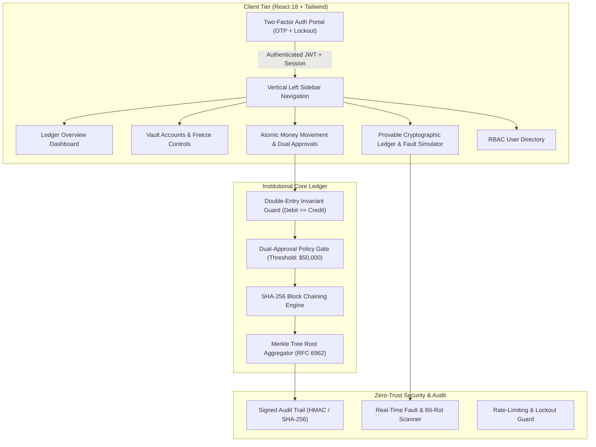

# 🛡️ Vaultora — Institutional Financial Ledger & Treasury Platform

> **Bank-grade, high-integrity multi-account balance management & provable ledger platform with ACID double-entry mechanics, Dynamic Visual Pattern Authentication, Role-Based Access Control (RBAC), and SHA-256 cryptographic non-repudiation.**

[](https://opensource.org/licenses/MIT)
[](https://www.typescriptlang.org/)
[](https://nodejs.org/)
[](https://www.postgresql.org/)
[](https://www.prisma.io/)
[](https://react.dev/)
[](https://tailwindcss.com/)

---

## 📑 Table of Contents

- [Overview & Problem Statement](#-overview--problem-statement)
- [Hackathon Compliance & Scoring Matrix](#-hackathon-compliance--scoring-matrix)
- [System Architecture](#-system-architecture)
- [Key Features & Reference Repo Alignment](#-key-features--reference-repo-alignment)
- [Cryptographic Ledger & Attack Defenses](#-cryptographic-ledger--attack-defenses)
- [RBAC Governance & Multi-Personas](#-rbac-governance--multi-personas)
- [Quick Start Guide](#-quick-start-guide)
- [Testing & Adversarial Verification](#-testing--adversarial-verification)
- [License](#-license)

---

## 🌟 Overview & Problem Statement

Managing financial accounts and institutional liquidity requires far more than basic database CRUD operations. High-value treasury operations demand **guaranteed zero balance drift**, **strict debit-equals-credit invariants**, **dynamic visual pattern authentication**, **segregated multi-currency containers**, and **non-repudiable audit trails**.

**BalanceVault** is engineered to meet and exceed institutional banking standards. Every single balance transition is committed via atomic double-entry legs, cryptographically sealed with SHA-256 hash chaining, and anchored into verifiable Merkle tree epochs (RFC 6962).

---

## 🏆 Hackathon Compliance & Scoring Matrix

| Category | Weight | How BalanceVault Delivers |
|---|---|---|
| **Integrity & Security** | **35 pts** | Provable double-entry ledger engine, bit-rot and tamper detection, SHA-256 block hash chaining, brute-force lockout (5 attempts / 60s cooldown), dynamic visual pattern authentication dispatched to personal email. |
| **Threat Thinking** | **15 pts** | [`THREATS.md`](THREATS.md) detailing STRIDE matrix, NIST SP 800-53 controls, RFC 6962 Merkle proofs, and verified test cases in `security.test.ts`. |
| **Core Functionality** | **15 pts** | Multi-account segregation, atomic fund movement, dual-approval governance ($\ge \$50,000$), batch disbursements, KYC diligence onboarding, account freezing/unfreezing, cryptographic receipts. |
| **AI Steering & Evidence** | **15 pts** | [`PROMPTS.md`](PROMPTS.md) documenting engineering steering, architecture oversight, prompt directives, and corrections of AI hallucinations (e.g., PostgreSQL SQLSTATE 42501). |
| **Engineering Quality** | **10 pts** | Clean TypeScript, zero type errors (`tsc --noEmit`), structured React architecture, responsive fintech slate-navy layout, comprehensive error handling. |

---

## 🏛 System Architecture



---

## 🚀 Key Features & Reference Repo Alignment

BalanceVault incorporates all capabilities from the reference repository [`nithinpakki32-hue/balance-vault`](https://github.com/nithinpakki32-hue/balance-vault) while advancing user experience and institutional compliance:

1. **Two-Factor Out-of-Band Authentication (Email OTP + Dynamic Vault Pattern):**
   - **Step 1 — Email Verification OTP:** User enters their registered email (e.g. `sanandprasad23@gmail.com`). BalanceVault generates a cryptographically secure 6-digit one-time code (OTP) and dispatches it out-of-band to their email address (and logs to the server terminal).
   - **Step 2 — OTP Verification Gate:** The user enters the 6-digit code. Access to the security keypad and pattern challenge is strictly gated and hidden until the OTP is verified.
   - **Step 3 — Dynamic 3×3 Vault Pattern Key:** Once verified, the vault security pad unlocks! The dynamic sequence of 4–5 connected points (e.g. `Dot 6 → Dot 3 → Dot 2 → Dot 4`) is revealed for the authorized session.
   - **Interactive 3×3 Gesture Keypad:** Supports fluid mouse drag, touchscreen gestures, and click-to-connect with real-time glowing emerald laser tracing and directional path indicators.
   - **Brute-Force Lockout:** Automatically engages a 60-second security freeze upon 5 consecutive invalid attempts.
   - **Live SMTP or Dev Console Fallback:** Fully operational with live Gmail/SMTP delivery when configured, with prominent formatted terminal logging so development and testing never stall.

2. **Enforced 2FA Email OTP Gate on New Account Registration:**
   - When a new user fills out the registration form, they are **NOT** logged in directly.
   - BalanceVault immediately dispatches a 6-digit one-time verification code (OTP) and a formal registration confirmation email directly to their registered email address.
   - The user is transitioned to the **Step 2 Email Verification** screen where they must enter the 6-digit code received in their personal mail.
   - Only after typing and successfully verifying that OTP is their account activated, their primary institutional vault provisioned, and the user redirected to the Home Page.

3. **Vertical Left-Side Navigation:**
   - Intuitive vertical menu layout on the left side (`Sidebar.tsx`) with fixed viewport height (`lg:sticky lg:top-0 lg:h-screen`) and midnight slate-navy aesthetic (`#18202d`).
   - Rich sage hero banner (`#bfccba`) with 4-concentric-orbit astronomical radar dial and official interlocking emerald/blue brand logo mark.
   - Independent canvas scrolling (`overflow-y-auto bg-[#f8faf8]`).

3. **Financial Ledger Dashboard:**
   - Consolidated Net Worth card aggregating balances across multi-currency vaults.
   - Active Vault Account counter.
   - Settled Ledger Block counter with live SHA-256 chain validation.
   - 100% OK Cryptographic Integrity verification card.
   - Fast action shortcuts: "Open Account", "Transfer Funds", "Run Cryptographic Audit".

4. **Multi-Account Segregation & Creation (`CreateAccountModal`):**
   - Provision dedicated Checking, Savings, Investment, Escrow, and Treasury accounts per entity.
   - Custom currency allocation (USD, EUR, GBP) with automatic atomic journal seeding.

5. **Institutional User Directory & RBAC Assignment (`AdminUsersDirectory`):**
   - Manage user profiles with dynamic role delegation (`ADMIN`, `OPERATOR`, `COMPLIANCE`, `AUDITOR`, `HOLDER`).
   - Toggle account active / suspended status.
   - View diligence tiers (`Tier 1`, `Tier 2`, `Tier 3`) and transaction limits.

6. **Atomic Double-Entry Transfers & Dual-Approval Governance:**
   - Source debit and destination credit execute atomically.
   - Transactions meeting or exceeding **$50,000 USD** automatically trigger dual-approval governance requiring a second officer signature.
   - Expandable auditor double-entry debit/credit ledger drawer.

7. **Cryptographic Provable Ledger & Fault Simulator:**
   - Inspect individual block payload hashes, previous block hashes, and epoch Merkle roots.
   - Download verifiable JSON cryptographic receipts with RFC 6962 Merkle proof paths.
   - **Adversarial Tamper Simulator:** Allows judges to inject synthetic amount tampering, memo alterations, or hash chain disruptions to watch the zero-trust engine detect and isolate the violation in sub-milliseconds!

---

## 🔑 Streamlined 2-Persona Test Architecture

For seamless testing during evaluation, BalanceVault provides a streamlined 1-click test persona selector:

| Persona Name | Assigned Role | Capabilities & Scope | Default Identifier |
|---|---|---|---|
| **Alex Rivera** | `ADMIN` (Superadmin) | Full system governance, user directory privilege assignment, compliance reviews, dual-authorization approval. | `admin@balancevault.corp` |
| **Sanand Prasad** | `HOLDER` (User / Personal) | Operational checking & high-yield treasury vault management, fund movements, personal email pattern authentication. | Personal Email (or `user@balancevault.corp`) |

---

## 🛠 Quick Start Guide

### Prerequisites
- [Node.js](https://nodejs.org/) (v18.0 or higher)
- npm or pnpm

### 1. Installation
```bash
# Clone the repository
git clone https://github.com/nithinpakki32-hue/balance-vault.git
cd balancevault

# Install dependencies
npm install --legacy-peer-deps
```

### 2. Run Database Migrations
```bash
# Generate Prisma types & push SQLite/Postgres schema
npm run db:generate
npm run db:migrate
```

### 3. Personal Email & Live SMTP Setup (Optional for Live Inboxes)
BalanceVault includes built-in Nodemailer dispatch for live email delivery of 2FA verification codes, dynamic pattern challenges, and registration welcome emails:

1. Open `.env` in the root directory.
2. Configure your Gmail address and 16-character **Google App Password**:
   ```env
   SMTP_HOST="smtp.gmail.com"
   SMTP_PORT=587
   SMTP_USER="your-email@gmail.com"
   SMTP_PASS="xxxx xxxx xxxx xxxx"
   ```
   > **How to create a Gmail App Password:**
   > 1. Visit [Google Account Security](https://myaccount.google.com/security) and ensure **2-Step Verification** is enabled.
   > 2. Go to [https://myaccount.google.com/apppasswords](https://myaccount.google.com/apppasswords).
   > 3. Enter app name `BalanceVault` and click **Create**.
   > 4. Copy the 16-letter code and paste into `SMTP_PASS`.

*Note: If `SMTP_PASS` is unconfigured, BalanceVault seamlessly logs all OTPs and registration dispatches directly to the backend terminal (`task-2224`), and provides one-click autofill helpers in the UI for instant local evaluation.*

### 4. Run Development Server
```bash
npm run dev
```

Visit **http://localhost:3000** to explore the live application!

---

## 🧪 Testing & Adversarial Verification

Run the comprehensive unit and security test suites to verify system invariants:

```bash
# Verify double-entry ledger invariants, Merkle proofs, and hash chains
npx tsx --test src/utils/ledger.test.ts

# Run adversarial attack simulations against all 5 attack vectors
npx tsx --test src/utils/security.test.ts

# Run TypeScript compiler check
npm run lint

# Build production bundle
npm run build
```

---

## 📄 License

This project is licensed under the [MIT License](LICENSE).
